# SolveLog: UML & Design Diagrams

Every diagram has three files:

- **`.mmd`**: the Mermaid source. Paste it into [mermaid.live](https://mermaid.live), GitHub, Notion or any Mermaid renderer to regenerate it
- **`.png`**: high-resolution image to copy on paper
- **`.svg`**: vector version (scales without blur)

The diagrams are deliberately small. Each shows every element its notation requires and nothing more, so it can be drawn by hand quickly in an exam. Each section lists the **must-have elements** (the "exam checklist").

| # | Diagram | Type |
|---|---|---|
| 1 | [Use Case Diagram](#01-use-case) | use case |
| 2 | [Class Diagram](#02-class) | class |
| 3 | [Object Diagram](#03-object) | object |
| 4 | [Sequence Diagram: Add Solution + AI Analysis](#04-sequence-add-solution) | sequence add solution |
| 5 | [Sequence Diagram: Extension Capture](#05-sequence-extension-capture) | sequence extension capture |
| 6 | [Activity Diagram: Log a Solved Problem](#06-activity-log-problem) | activity log problem |
| 7 | [State Machine Diagram: Revision Card](#07-state-review-card) | state review card |
| 8 | [ER Diagram (Crow's Foot / IE notation)](#08-er-crowsfoot) | er crowsfoot |
| 9 | [ER Diagram (Chen notation)](#09-er-chen) | er chen |
| 10 | [Package Diagram](#10-package) | package |
| 11 | [Component Diagram](#11-component) | component |
| 12 | [Deployment Diagram](#12-deployment) | deployment |
| 13 | [Communication (Collaboration) Diagram: Grade a Card](#13-communication) | communication |
| 14 | [Control Flow Graph: `cfRatingToDifficulty()`](#14-cfg) | cfg |
| 15 | [DFD Level 0 (Context Diagram)](#15-dfd-level0) | dfd level0 |
| 16 | [DFD Level 1](#16-dfd-level1) | dfd level1 |

---

<a id="01-use-case"></a>
## Use Case Diagram

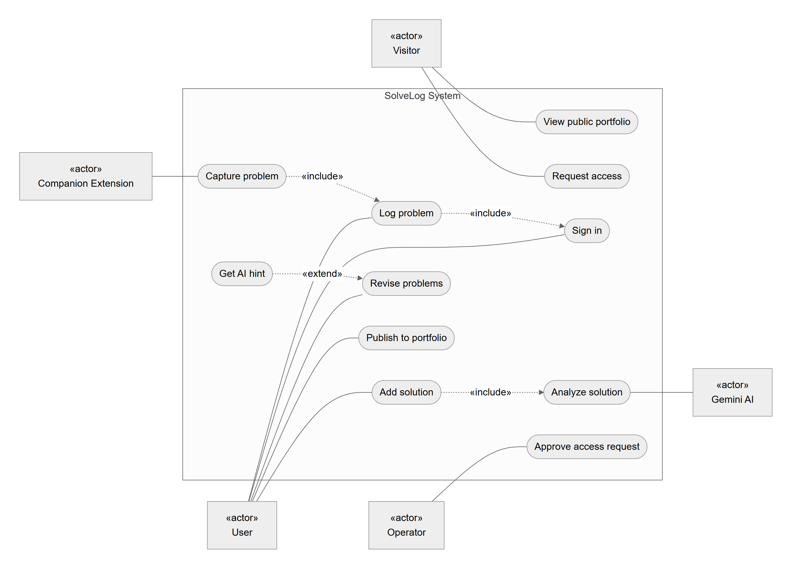

**Exam checklist**

- System boundary box with the system name on top
- Actors outside the boundary (draw stick figures on paper); primary actors on the left, secondary (Gemini AI, extension) on the right
- Use cases as ellipses with verb-phrase names ("Log problem", not "Problem")
- Association = plain solid line, no arrowhead (actor to use case)
- `<<include>>` = dashed arrow from base use case to the always-included one
- `<<extend>>` = dashed arrow from the optional extension to the base use case (Get AI hint extends Revise problems)

> Mermaid has no native use-case type, so this uses a flowchart: rounded boxes = ellipses, «actor» boxes = stick figures.

<details><summary>Mermaid source (<code>01-use-case.mmd</code>)</summary>

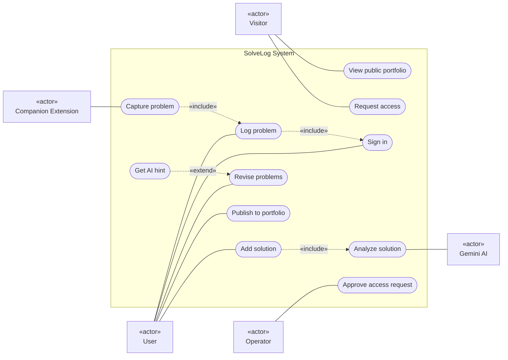
</details>

---

<a id="02-class"></a>
## Class Diagram

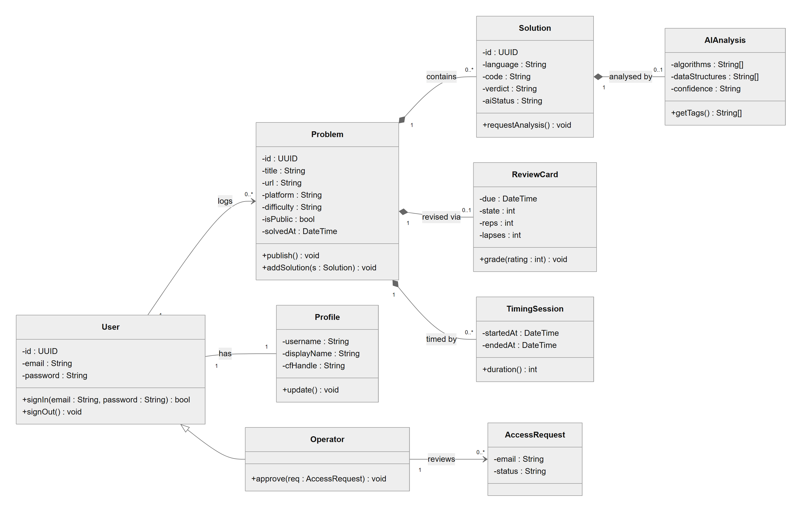

**Exam checklist**

- Three compartments: class name / attributes / operations
- Attributes as `visibility name : Type`. Types are *optional in the UML spec* but expected in exams and design-level diagrams, so always write them
- Operations as `visibility name(param : Type) : ReturnType`
- Visibility symbols: `+` public, `-` private, `#` protected, `~` package
- Multiplicity at both ends of every association (`1`, `0..1`, `0..*`)
- Relationship symbols: generalization = hollow triangle (Operator is a User); composition = filled diamond on the whole (Problem contains Solution); plain association = line with name

> Mermaid prints the return type after the parentheses; on paper write it as `+signIn(email : String, password : String) : bool`.

<details><summary>Mermaid source (<code>02-class.mmd</code>)</summary>

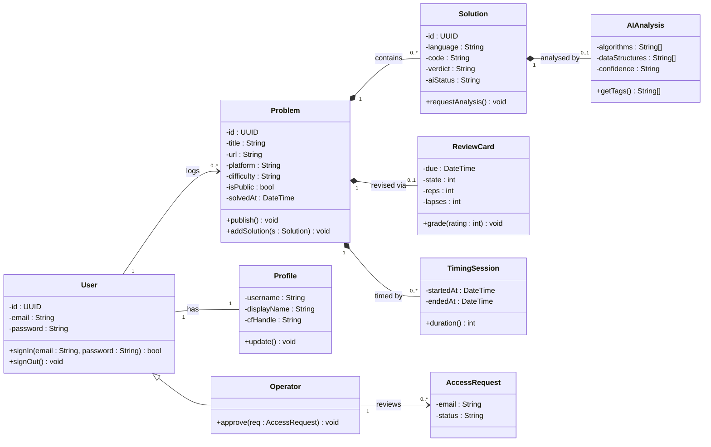
</details>

---

<a id="03-object"></a>
## Object Diagram

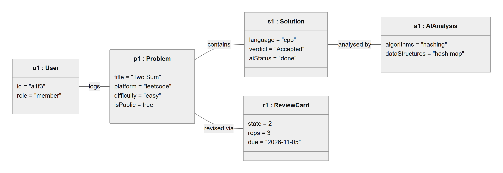

**Exam checklist**

- Object box title is `objectName : ClassName` and is **underlined** (Mermaid cannot underline, so underline it on paper)
- Only attribute **values** (`title = "Two Sum"`), no types and no operations compartment
- Links are plain lines with no multiplicity; each link is an instance of an association in the class diagram
- Shows one snapshot of the system at one moment

> Mermaid draws an empty third compartment; leave it out on paper.

<details><summary>Mermaid source (<code>03-object.mmd</code>)</summary>

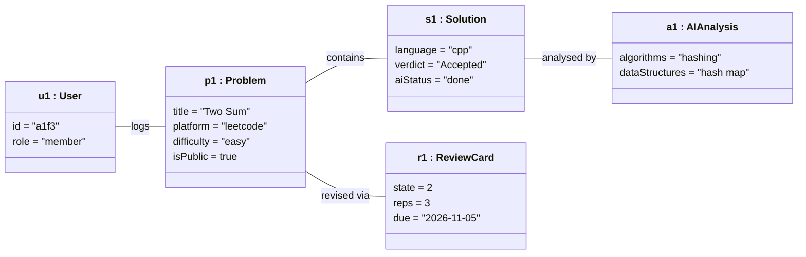
</details>

---

<a id="04-sequence-add-solution"></a>
## Sequence Diagram: Add Solution + AI Analysis

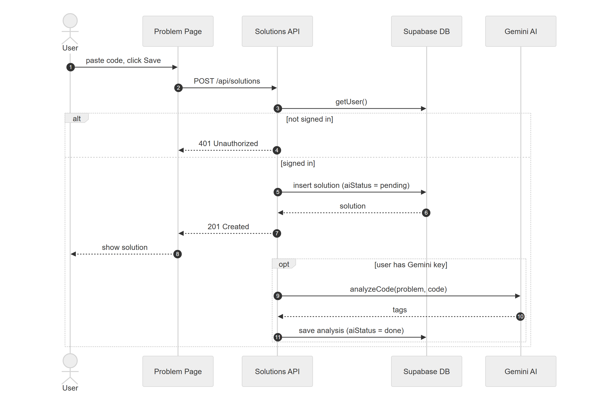

**Exam checklist**

- Participants across the top; actor as a stick figure
- Dashed vertical lifeline under each participant (add activation bars when drawing)
- Synchronous message = solid line with filled arrowhead; return = dashed line with open arrowhead
- Messages numbered in time order, top to bottom
- Combined fragments: `alt` (if/else with [guards]) and `opt` (optional with [guard])

<details><summary>Mermaid source (<code>04-sequence-add-solution.mmd</code>)</summary>

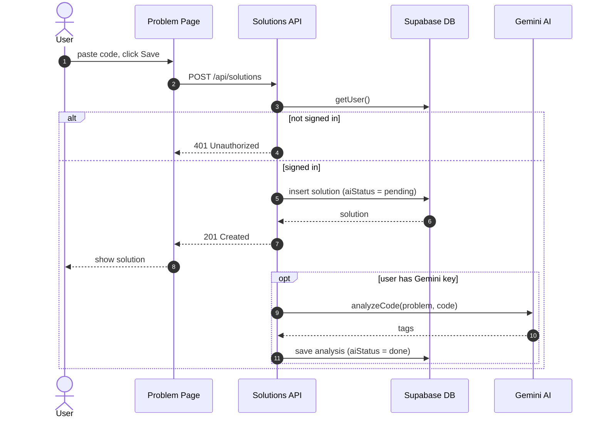
</details>

---

<a id="05-sequence-extension-capture"></a>
## Sequence Diagram: Extension Capture

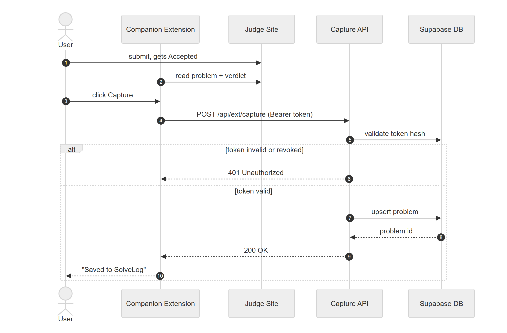

**Exam checklist**

- Same notation as above
- Shows the bearer-token check and the `alt` fragment for an invalid or revoked token

<details><summary>Mermaid source (<code>05-sequence-extension-capture.mmd</code>)</summary>

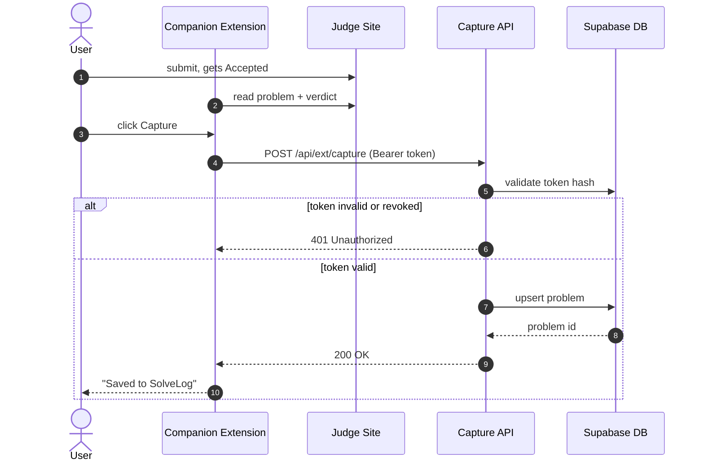
</details>

---

<a id="06-activity-log-problem"></a>
## Activity Diagram: Log a Solved Problem

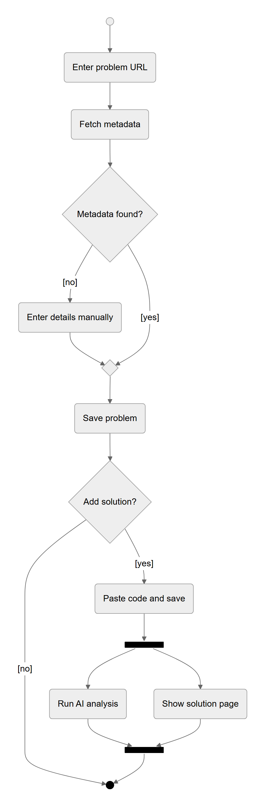

**Exam checklist**

- Initial node = filled black circle; final node = bull's-eye (circle with a filled centre)
- Actions = rounded rectangles
- Decision and merge = diamond; every outgoing branch carries a `[guard]`
- Fork and join = thick black bar (AI analysis runs in parallel with showing the page)
- One entry and at least one exit; flows are arrows

<details><summary>Mermaid source (<code>06-activity-log-problem.mmd</code>)</summary>

```mermaid
flowchart TD
  S@{ shape: sm-circ, label: "start" }
  A(Enter problem URL)
  B(Fetch metadata)
  C{Metadata found?}
  D(Enter details manually)
  M{" "}
  E(Save problem)
  F{Add solution?}
  G(Paste code and save)
  FK@{ shape: fork, label: "fork" }
  H(Run AI analysis)
  I(Show solution page)
  JN@{ shape: fork, label: "join" }
  X@{ shape: fr-circ, label: "end" }

  S --> A --> B --> C
  C -- "[no]" --> D --> M
  C -- "[yes]" --> M
  M --> E --> F
  F -- "[no]" --> X
  F -- "[yes]" --> G --> FK
  FK --> H --> JN
  FK --> I --> JN
  JN --> X

  style S fill:#000,stroke:#000
  style FK fill:#000,stroke:#000
  style JN fill:#000,stroke:#000
  style X fill:#000,stroke:#000
```
</details>

---

<a id="07-state-review-card"></a>
## State Machine Diagram: Revision Card

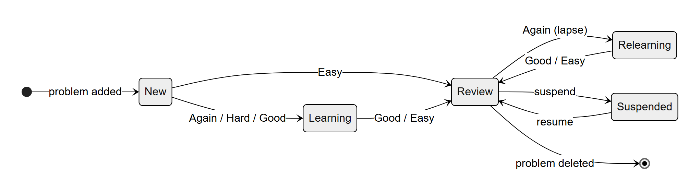

**Exam checklist**

- Initial pseudostate = filled circle; final state = bull's-eye
- States = rounded rectangles named as conditions (New, Learning, Review…)
- Transitions = arrows labelled `event [guard] / action`; here the event is the grade given
- Models one object's life cycle (an FSRS review card)

> Self-loops (Learning→Learning on Again/Hard, Review→Review on Hard/Good/Easy, Relearning→Relearning on Again) are left out to keep it drawable. Add them as small loops if asked for completeness.

<details><summary>Mermaid source (<code>07-state-review-card.mmd</code>)</summary>

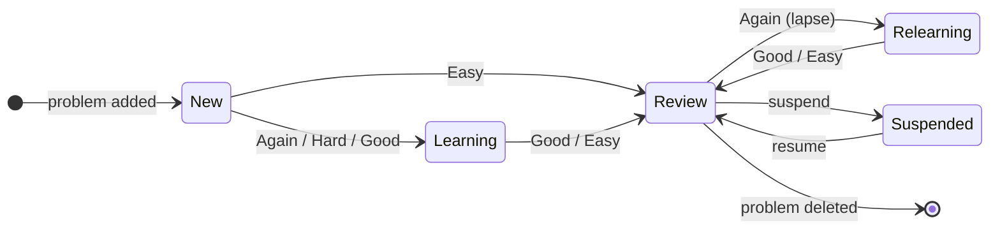
</details>

---

<a id="08-er-crowsfoot"></a>
## ER Diagram (Crow's Foot / IE notation)

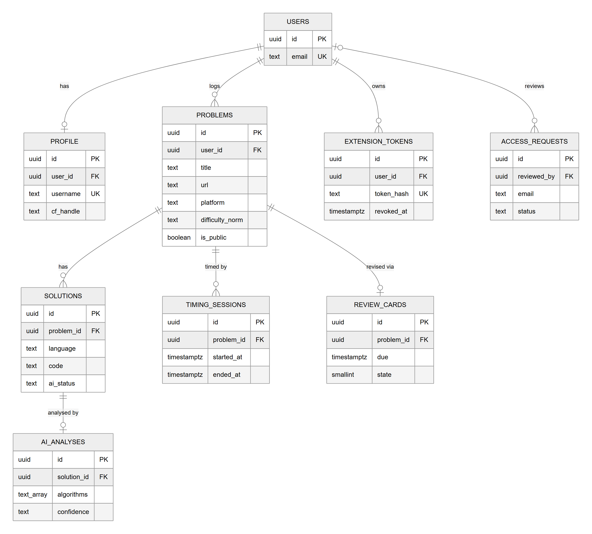

**Exam checklist**

- Entity = box with name; attributes listed with data types
- Mark keys: `PK` primary, `FK` foreign, `UK` unique
- Cardinality symbols at both ends: `||` exactly one, `o|` zero or one, `o{` zero or many
- Relationship name on the line (verb)

> Matches the real Postgres schema (supabase/migrations). Only key attributes are shown so it stays drawable.

<details><summary>Mermaid source (<code>08-er-crowsfoot.mmd</code>)</summary>

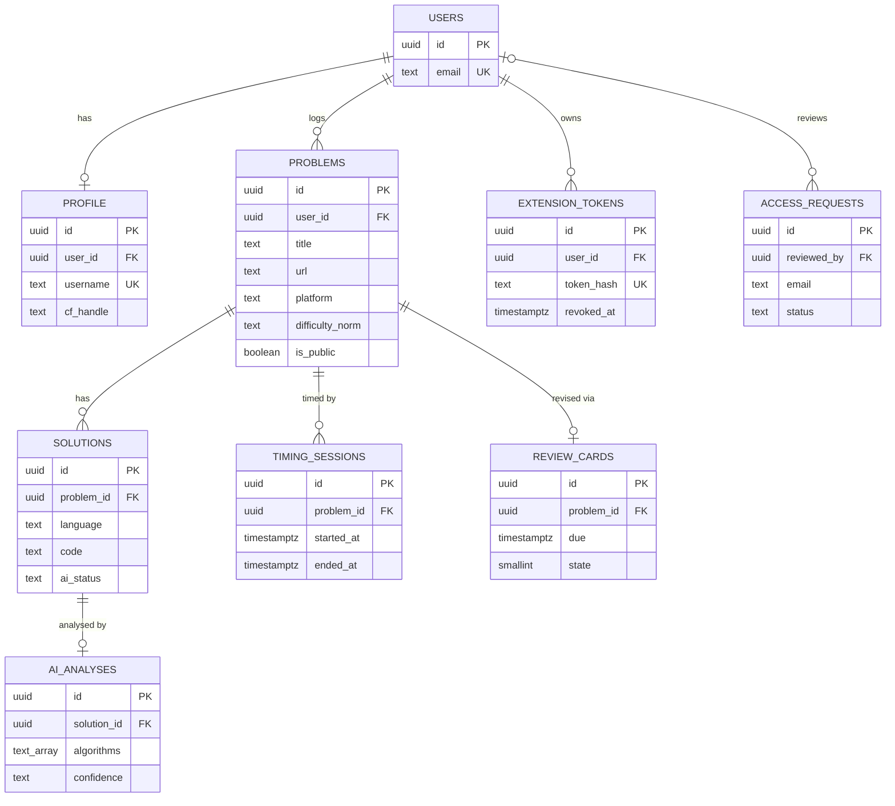
</details>

---

<a id="09-er-chen"></a>
## ER Diagram (Chen notation)

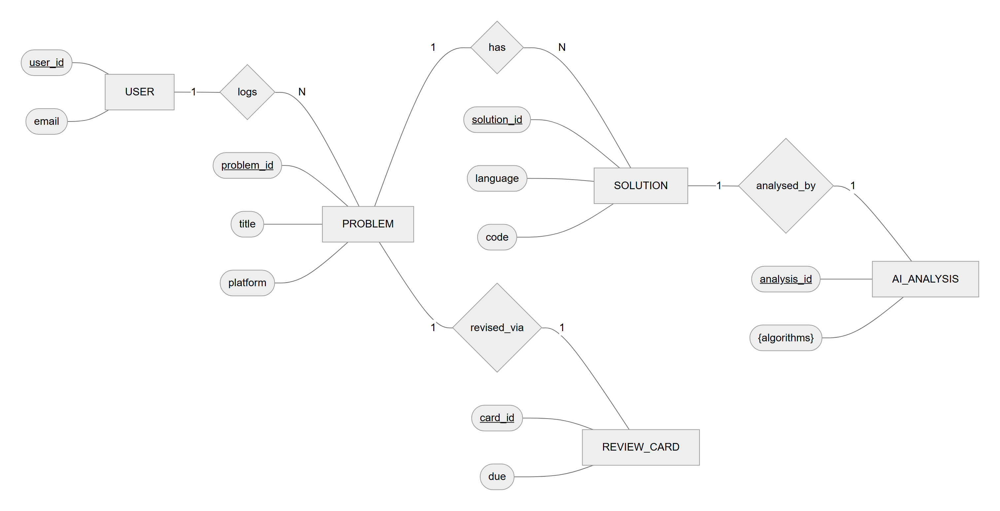

**Exam checklist**

- Entity = rectangle, relationship = diamond, attribute = ellipse
- Primary-key attribute name **underlined**
- Multivalued attribute = double ellipse (shown as `{algorithms}`)
- Cardinality (1, N) written on the lines either side of the diamond

> Use this one if your syllabus or teacher expects Chen notation; it's common in Indian university exams. Mermaid draws ellipses as pills.

<details><summary>Mermaid source (<code>09-er-chen.mmd</code>)</summary>

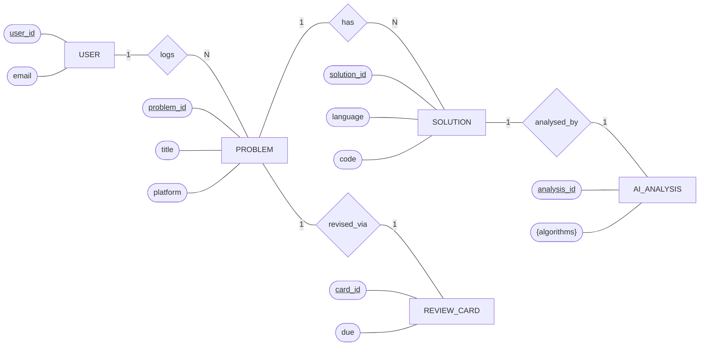
</details>

---

<a id="10-package"></a>
## Package Diagram

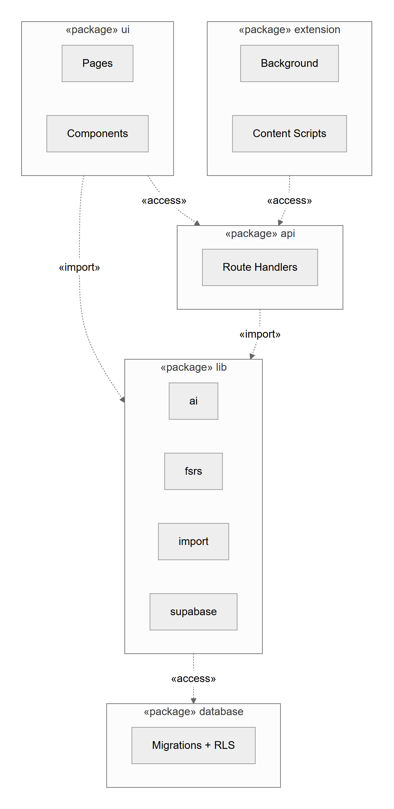

**Exam checklist**

- Package = folder shape (rectangle with a small tab on the top-left) with the name in or on the tab
- Elements drawn inside their package
- Dependency = dashed arrow with open arrowhead, stereotyped `«import»` or `«access»`

> Draw the tab on paper; Mermaid draws packages as plain boxes.

<details><summary>Mermaid source (<code>10-package.mmd</code>)</summary>

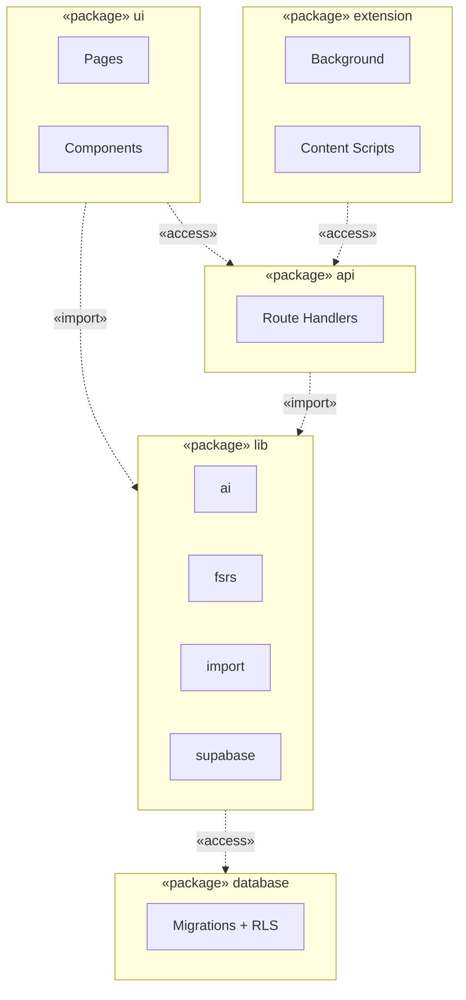
</details>

---

<a id="11-component"></a>
## Component Diagram

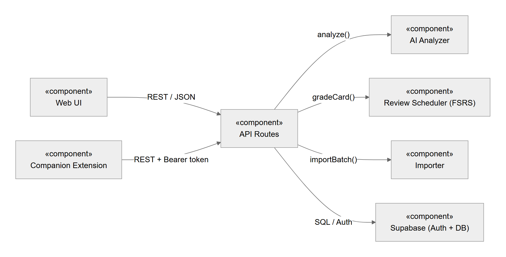

**Exam checklist**

- Component = rectangle with the `«component»` stereotype (or the small two-tab icon in the corner)
- Provided interface = lollipop (circle), required interface = socket (half circle); here interfaces are written as labels on the connectors
- Dependencies between components as arrows

<details><summary>Mermaid source (<code>11-component.mmd</code>)</summary>

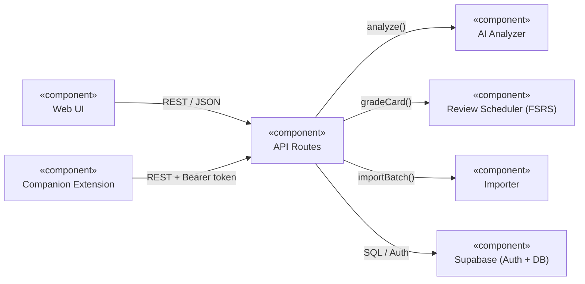
</details>

---

<a id="12-deployment"></a>
## Deployment Diagram

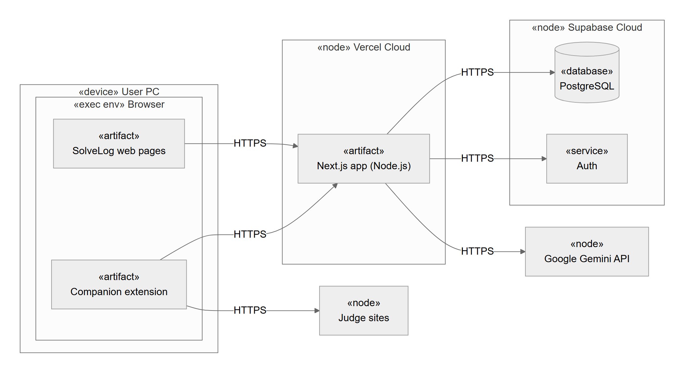

**Exam checklist**

- Node = 3-D box (cube), stereotyped `«device»` or `«execution environment»`
- Artifacts (deployed files or apps) drawn inside nodes with `«artifact»`
- Communication paths between nodes labelled with the protocol (HTTPS)
- Nodes can nest (Browser inside the PC)

> Draw nodes as cubes on paper.

<details><summary>Mermaid source (<code>12-deployment.mmd</code>)</summary>

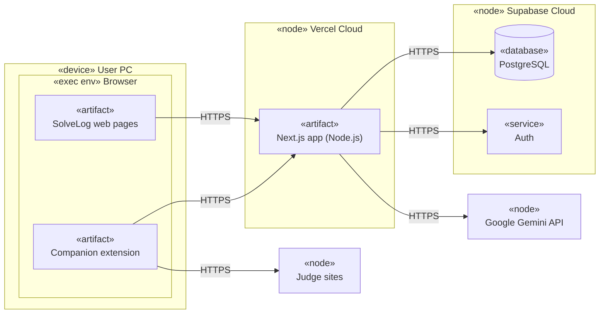
</details>

---

<a id="13-communication"></a>
## Communication (Collaboration) Diagram: Grade a Card

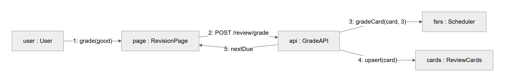

**Exam checklist**

- Objects as `name : Class` boxes (underline on paper)
- Links between objects as plain lines
- Messages written along links with sequence numbers `1:`, `2:` … and a small arrow showing direction
- Same interaction as a sequence diagram, but organised by structure, not time

<details><summary>Mermaid source (<code>13-communication.mmd</code>)</summary>

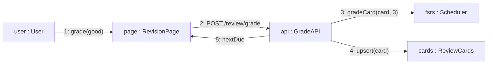
</details>

---

<a id="14-cfg"></a>
## Control Flow Graph: `cfRatingToDifficulty()`


**Exam checklist**

- Nodes = numbered statements or decision points; edges = possible flow of control
- Decision nodes have T and F edges
- Single entry (1) and single exit (10)
- Cyclomatic complexity: V(G) = E − N + 2 = 13 − 10 + 2 = **5** (or predicates + 1 = 4 + 1 = 5)

> 

Source (lib/difficulty.ts):

```ts
function cfRatingToDifficulty(rating) {
  if (!rating || rating <= 0) return "unknown";   // 1 -> 2
  if (rating < 1300) return "easy";               // 3 -> 4
  if (rating < 1900) return "medium";             // 5 -> 6
  if (rating < 2400) return "hard";               // 7 -> 8
  return "expert";                                // 9
}                                                 // 10 (exit)
```

Independent paths: 1-2-10, 1-3-4-10, 1-3-5-6-10, 1-3-5-7-8-10, 1-3-5-7-9-10.

<details><summary>Mermaid source (<code>14-cfg.mmd</code>)</summary>

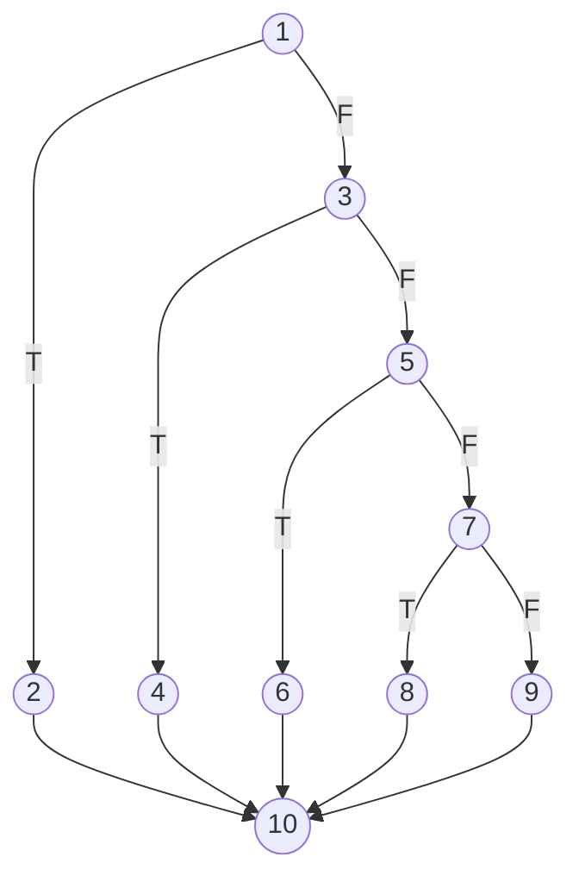
</details>

---

<a id="15-dfd-level0"></a>
## DFD Level 0 (Context Diagram)

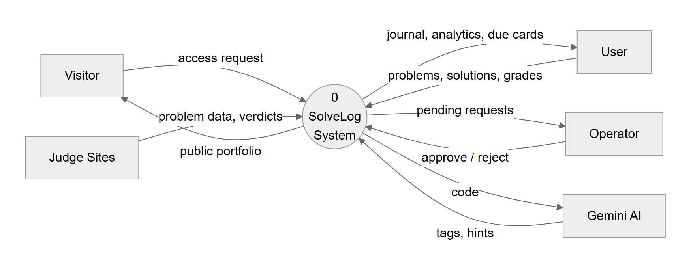

**Exam checklist**

- Exactly **one** process (bubble numbered 0) = the whole system
- External entities = rectangles
- Data flows = labelled arrows (label with *data*, not actions)
- No data stores at level 0

<details><summary>Mermaid source (<code>15-dfd-level0.mmd</code>)</summary>

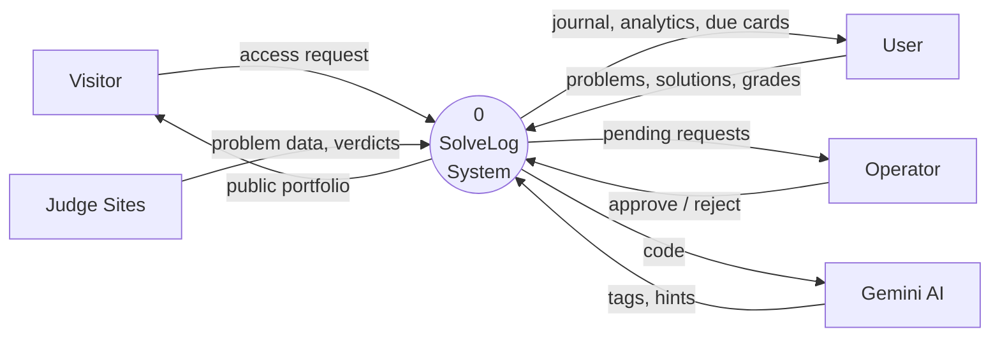
</details>

---

<a id="16-dfd-level1"></a>
## DFD Level 1

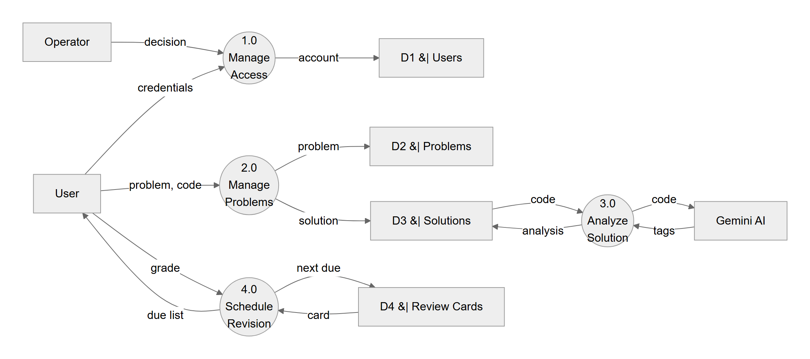

**Exam checklist**

- Level 0 process broken into numbered sub-processes (1.0, 2.0 …)
- Data stores = open-ended rectangle (two parallel lines) labelled `D1 | Users`
- Inputs and outputs must **balance** with level 0 (same external entities)
- Every process has at least one input and one output; data never flows store-to-store or entity-to-store directly

> Draw stores on paper as two parallel horizontal lines with the ID in a small left box.

<details><summary>Mermaid source (<code>16-dfd-level1.mmd</code>)</summary>

```mermaid
flowchart LR
  U[User]
  O[Operator]
  G[Gemini AI]

  P1(("1.0<br/>Manage<br/>Access"))
  P2(("2.0<br/>Manage<br/>Problems"))
  P3(("3.0<br/>Analyze<br/>Solution"))
  P4(("4.0<br/>Schedule<br/>Revision"))

  D1["D1 &#124; Users"]
  D2["D2 &#124; Problems"]
  D3["D3 &#124; Solutions"]
  D4["D4 &#124; Review Cards"]

  O -- decision --> P1
  U -- credentials --> P1
  P1 -- account --> D1
  U -- problem, code --> P2
  P2 -- problem --> D2
  P2 -- solution --> D3
  D3 -- code --> P3
  P3 -- code --> G
  G -- tags --> P3
  P3 -- analysis --> D3
  U -- grade --> P4
  D4 -- card --> P4
  P4 -- next due --> D4
  P4 -- due list --> U
```
</details>
