

# SolveLog

## A Practice Journal, Spaced-Revision System and Public Portfolio for Competitive Programmers

### Project Report: Software Requirements Specification (IEEE 830 format)
### with UML Diagrams, Estimation, Test Cases, Testing Techniques and Results

 

**Submitted by:** Manthan Vats

**Live application:** https://solvelog.vercel.app

**Source code:** https://github.com/Manthan-Vats/competitive-programming-journal

**Diagrams and report repository:** https://github.com/Manthan-Vats/SolveLog-SE-Project

**Date:** November 2026

## Table of Contents

1. Introduction
2. Overall Description
3. Specific Requirements
4. System Design and UML Diagrams
5. Project Estimation
6. Testing: Techniques, Test Cases and Results
7. Implementation and Screenshots
8. Conclusion and Future Scope
9. References

Appendix A: Glossary · Appendix B: Requirements Traceability Matrix

## 1. Introduction

### 1.1 Purpose

This document is the Software Requirements Specification (SRS) and project report for **SolveLog**. It
defines what the system must do (functional requirements), how well it must do it (non-functional
requirements), and how it was designed, estimated, built and tested. The intended readers are the
project evaluator, future maintainers of the code base, and anyone deploying their own instance.

### 1.2 Problem Statement

Competitive programmers solve problems on many judges (Codeforces, LeetCode, AtCoder, CodeChef …),
but their work ends up scattered. Three things are missing:

1. **Retention.** A problem solved once is usually forgotten within weeks, because nothing schedules
   a revisit at the right time.
2. **Insight.** Judges show a verdict, not the *pattern* that was used (two pointers, DP on trees …),
   so learners cannot see which techniques they rely on or avoid.
3. **Proof of work.** No single, curated page shows a recruiter or mentor what someone has actually
   solved and how.

### 1.3 Scope

SolveLog is a multi-tenant web application plus a companion browser extension that:

- captures problems and accepted solutions from judge sites (one click, or automatic import)
- stores them in a private, per-user journal with timing data
- tags each solution with algorithms, data structures and techniques using AI (Google Gemini, with a
  bring-your-own-key model)
- schedules revision with the **FSRS** spaced-repetition algorithm
- shows analytics (streaks, heatmap, pattern coverage, weakest area)
- publishes a curated public portfolio at `/u/<handle>` with shareable achievement cards

Out of scope: running or judging code (no online judge), contests, and social features such as
following or comments.

### 1.4 Definitions, Acronyms and Abbreviations

| Term | Meaning |
|---|---|
| Judge | An online platform that hosts problems and verifies submissions (e.g., Codeforces) |
| FSRS | Free Spaced Repetition Scheduler, a modern memory model that computes the next review date |
| RLS | Row Level Security, Postgres policies that restrict which rows a user can read or write |
| BYOK | Bring Your Own Key: each user supplies their own Gemini API key |
| Operator | The single administrator who approves access requests |
| Companion | The SolveLog browser extension (Chrome / Firefox, Manifest V3) |
| SRS | Software Requirements Specification |
| SSR | Server-Side Rendering |

### 1.5 References

See Section 9.

### 1.6 Overview of the Document

Section 2 describes the product at a high level. Section 3 lists the detailed requirements.
Section 4 presents the design through 16 UML and structured-analysis diagrams. Section 5 estimates
size, effort and cost. Section 6 covers testing techniques, test cases and results. Sections 7–8
show the implementation and conclude.

## 2. Overall Description

### 2.1 Product Perspective

SolveLog is a new, self-contained product. It follows a three-tier, cloud-hosted architecture:

- **Presentation tier:** Next.js (React 19) pages, server-rendered and hydrated in the browser, plus
  the Companion extension.
- **Application tier:** Next.js route handlers (`/api/**`) on Vercel's Node.js runtime.
- **Data tier:** Supabase (PostgreSQL 15 + Auth), where Row Level Security is the security boundary.

External systems: Google Gemini (with Groq as a fallback provider) for AI analysis, and the
public APIs and pages of Codeforces and LeetCode for imports and handle verification.

### 2.2 Product Functions (summary)

1. Invite-only access: request access → operator approves → invite email → set password → sign in
2. Problem journal: create, edit, delete and search problems; metadata auto-filled from the URL
3. Solutions: multiple per problem, with language, code (Monaco editor), verdict and runtime
4. Timing: start/stop timer per attempt (web or extension widget)
5. AI analysis: tags each solution; AI hints, code critique and "pattern card" during revision (cached)
6. Revision: FSRS-scheduled queue; grade Again / Hard / Good / Easy; suspend a card
7. Analytics: streak, activity heatmap, difficulty and platform split, pattern coverage
8. Public portfolio: per-problem publish toggles, public profile, achievement card and rating badges
9. Companion extension: one-click capture, floating timer, bulk import of past submissions
10. Settings: profile, verified judge handles, AI key, extension tokens, theme, account deletion

### 2.3 User Classes and Characteristics

| User class | Description | Technical skill |
|---|---|---|
| Visitor | Not signed in; views public portfolios and can request access | Any |
| User (member) | Invited programmer who keeps a private journal | Comfortable with judges and browsers |
| Operator | Runs the instance; approves or rejects access requests | High |

### 2.4 Operating Environment

- **Client:** any modern browser (Chrome, Edge, Firefox, Safari), desktop or mobile; extension on
  Chromium browsers and Firefox
- **Server:** Vercel (Node.js 24 runtime, serverless functions)
- **Database:** Supabase-hosted PostgreSQL with Supabase Auth

### 2.5 Design and Implementation Constraints

- The browser holds a **public** Supabase anon key, so every table must be protected by RLS.
- Service-role key is server-only and never exposed with a `NEXT_PUBLIC_` prefix.
- Judge solution code is behind the user's own judge session; the server must **never** store
  judge credentials. Imports therefore run inside the user's browser via the extension.
- Free-tier hosting limits (function duration, database size, AI quota) shape the design: AI work
  runs after the response (`after()`), and AI results are cached.

### 2.6 Assumptions and Dependencies

- Users have an account on at least one supported judge.
- Gemini API keys are available free of charge from Google AI Studio.
- Judge sites keep their public page structure and APIs reasonably stable; parsers are covered by
  fixture tests so breakage is detected.

## 3. Specific Requirements

### 3.1 External Interface Requirements

**User interfaces.** Responsive web UI with a paper-notebook theme (light by default, optional dark
"night file" theme). Main screens: landing, login, dashboard, problems list, problem detail,
add problem, analytics, revision, settings, invites (operator), public portfolio.

**Hardware interfaces.** None beyond a standard PC or phone.

**Software interfaces.**

| Interface | Purpose | Protocol |
|---|---|---|
| Supabase Auth | Sign-in, invites, password reset | HTTPS / JWT cookies |
| Supabase PostgREST | All data access under RLS | HTTPS / JSON |
| Google Gemini API | Solution analysis, hints, critique | HTTPS / JSON |
| Groq API | Fallback AI provider | HTTPS / JSON |
| Codeforces API | Metadata, user stats, handle verification | HTTPS / JSON |
| LeetCode GraphQL | Metadata, stats, imports | HTTPS / GraphQL |

**Communication interfaces.** HTTPS only. The extension authenticates with a revocable bearer token
(only its SHA-256 hash is stored server-side).

### 3.2 Functional Requirements

| ID | Requirement | Priority |
|---|---|---|
| FR-1 | A visitor shall be able to submit an access request with a valid email address. | High |
| FR-2 | The operator shall be able to approve (send invite) or reject a pending request. | High |
| FR-3 | An invited user shall set a password and sign in with email and password; a forgotten password can be reset by email. | High |
| FR-4 | A signed-in user shall create, edit, delete and list their own problems. | High |
| FR-5 | When a problem URL is entered, the system shall fetch title, difficulty and tags from the judge where possible. | Medium |
| FR-6 | A user shall attach one or more solutions (language, code ≤ 100,000 chars, verdict) to a problem. | High |
| FR-7 | A user shall record timed attempts (start, stop, manual entry). | Medium |
| FR-8 | If the user has stored a Gemini key, the system shall analyse each new or changed solution and store algorithms, data structures, techniques and confidence. | Medium |
| FR-9 | The system shall keep a revision card per problem and compute the next due date with FSRS after each grade (Again / Hard / Good / Easy). | High |
| FR-10 | A user shall be able to suspend and resume a problem's revision card. | Low |
| FR-11 | During revision, a user may request an AI hint, a critique of their code, or a pattern card; results are cached per problem and code hash. | Low |
| FR-12 | The system shall show analytics: streak, heatmap, counts by difficulty and platform, and pattern coverage. | Medium |
| FR-13 | A user shall choose which problems and which solution code are public; everything is private by default. | High |
| FR-14 | Anyone shall be able to view a user's public portfolio at `/u/<handle>` and download an achievement card image. | Medium |
| FR-15 | A user shall verify ownership of a judge handle with a one-time token and display verified stats. | Low |
| FR-16 | The Companion extension shall capture the current judge problem and accepted solution with one click. | High |
| FR-17 | The extension shall import past accepted submissions in bulk without the server ever seeing judge credentials. | Medium |
| FR-18 | A user shall be able to create, label and revoke extension tokens. | High |
| FR-19 | A user shall be able to store, replace and delete their AI key; it is encrypted at rest. | Medium |
| FR-20 | A user shall be able to permanently delete their account and all owned data. | Medium |

### 3.3 Non-Functional Requirements

| ID | Category | Requirement |
|---|---|---|
| NFR-1 | Security | Every table has RLS; a user can read or write only their own rows, plus rows explicitly published by their owner. |
| NFR-2 | Security | Secrets (service-role key, AI-key encryption key) never reach the client. AI keys are encrypted with AES-256-GCM. |
| NFR-3 | Security | Extension tokens are stored only as SHA-256 hashes and can be revoked. |
| NFR-4 | Security | Write and AI endpoints are rate-limited (Postgres-backed fixed window); the limiter fails open. |
| NFR-5 | Performance | Landing page time-to-first-byte under 1 s; Lighthouse performance score of 90 or more. |
| NFR-6 | Performance | Saving a solution must not wait on AI; AI runs after the HTTP response. |
| NFR-7 | Reliability | An AI outage must never fail a create or update; the solution is marked `ai_status = failed` instead. |
| NFR-8 | Usability | Responsive down to 360 px width; keyboard-navigable forms; light and dark themes. |
| NFR-9 | Maintainability | TypeScript strict mode; shared enums in one module; parsers covered by fixture tests. |
| NFR-10 | Portability | Runs on any Next.js host plus any Supabase project; schema is fully reproducible from 17 SQL migrations. |
| NFR-11 | Privacy | Data is private by default; publishing is an explicit per-item action. |

### 3.4 Database Requirements

The persistent data model has 13 relations (see Section 4.8): `problems`, `solutions`,
`ai_analyses`, `timing_sessions`, `profile`, `review_cards`, `extension_tokens`, `access_requests`,
`platform_verifications`, `user_ai_keys`, `ai_assists`, `rate_limits`, and Supabase's `auth.users`.
All user-owned tables carry a `user_id` foreign key to `auth.users` with `ON DELETE CASCADE`, so
deleting an account removes its data.

## 4. System Design and UML Diagrams

All diagrams are kept intentionally compact. The Mermaid source for every diagram is in
the `diagrams/` folder of the report repository and can be regenerated in any Mermaid renderer.

### 4.1 Use Case Diagram

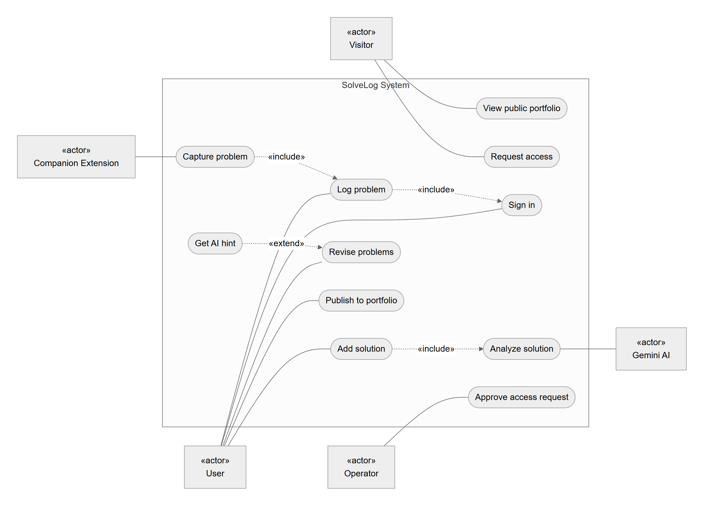

Three human actors (Visitor, User, Operator) and two system actors (Companion Extension, Gemini AI).
*Log problem* includes *Sign in*; *Add solution* includes *Analyze solution*; *Get AI hint* is an
optional extension of *Revise problems*.

**Use case specification: UC-5 Add Solution**

| Field | Description |
|---|---|
| Actor | User |
| Pre-condition | User is signed in and owns the problem |
| Main flow | 1. User opens a problem. 2. Pastes code and selects language. 3. Clicks Save. 4. System validates and stores the solution. 5. System shows it with AI status "pending". 6. If a key is set, the system analyses the code and shows the tags. |
| Alternate flow | 4a. Code empty or over 100,000 chars → error shown, nothing saved. 6a. No AI key → status "none", no tags. 6b. AI fails → status "failed"; the solution is still saved. |
| Post-condition | Solution stored; analysis stored if available |

### 4.2 Class Diagram

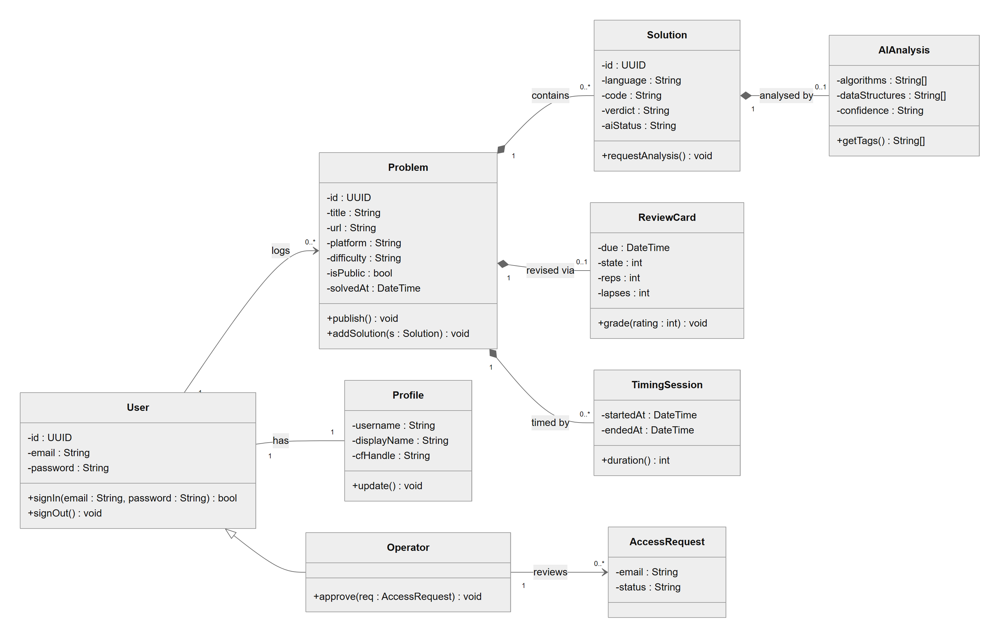

Operator specialises User. A Problem is composed of Solutions, TimingSessions and at most one
ReviewCard; a Solution owns at most one AIAnalysis.

### 4.3 Object Diagram

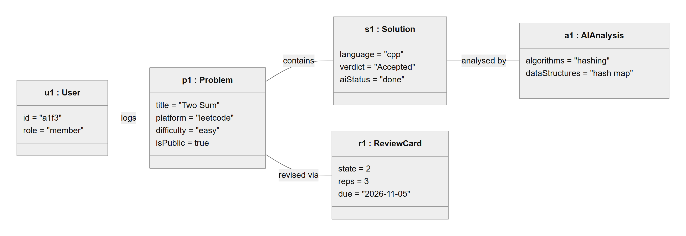

A snapshot after a user logs "Two Sum", saves an accepted C++ solution that the AI tags as hashing,
and has reviewed the problem three times.

### 4.4 Sequence Diagrams

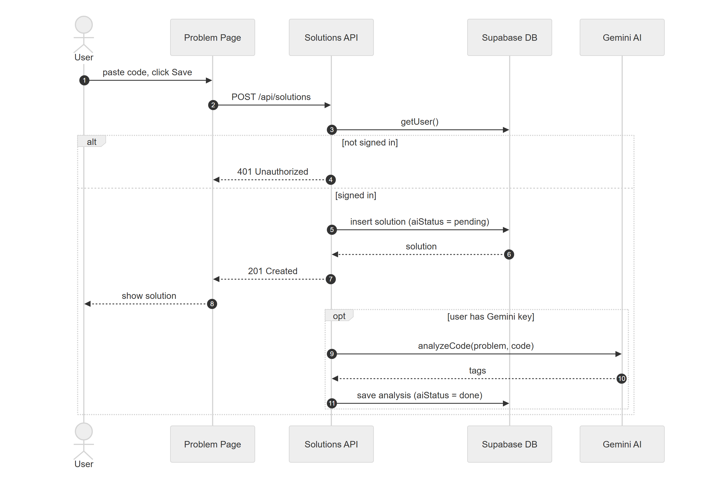

The response (201) returns **before** the AI call, which runs in `after()`; this implements NFR-6.

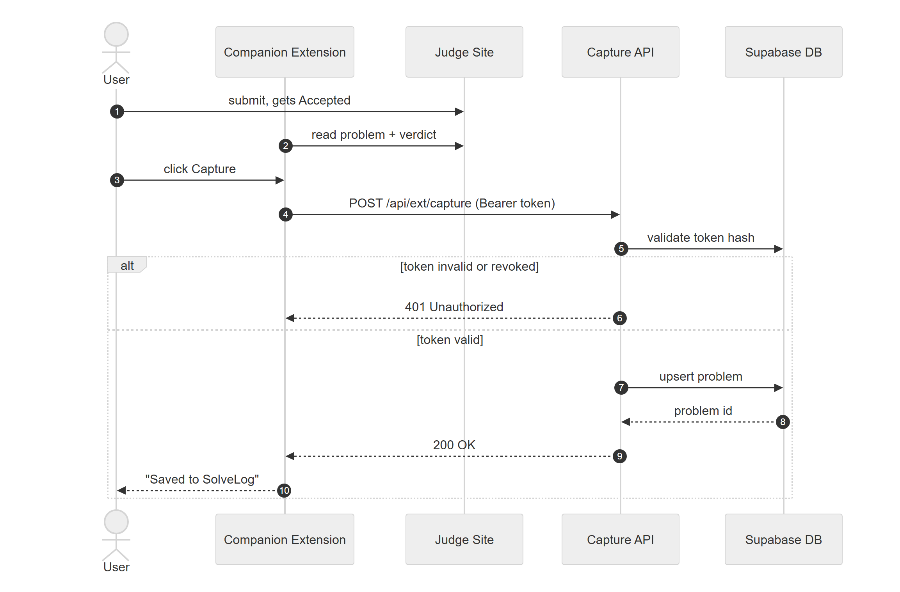

### 4.5 Activity Diagram

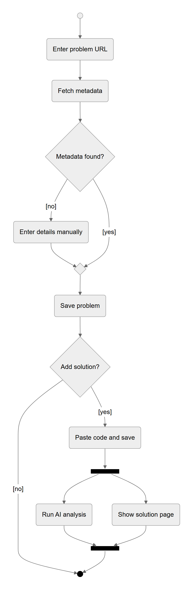

### 4.6 State Machine Diagram

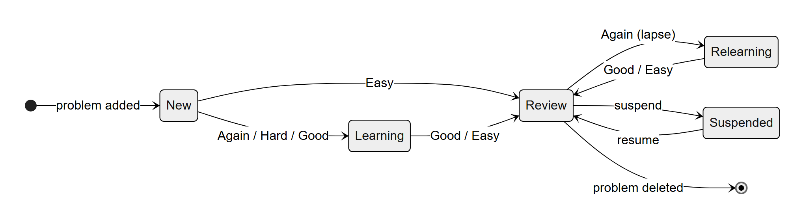

FSRS card states: New → Learning → Review, with Relearning after a lapse.

### 4.7 Communication Diagram

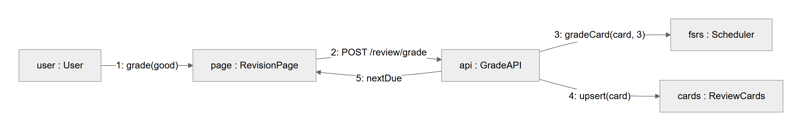

### 4.8 Entity-Relationship Diagrams

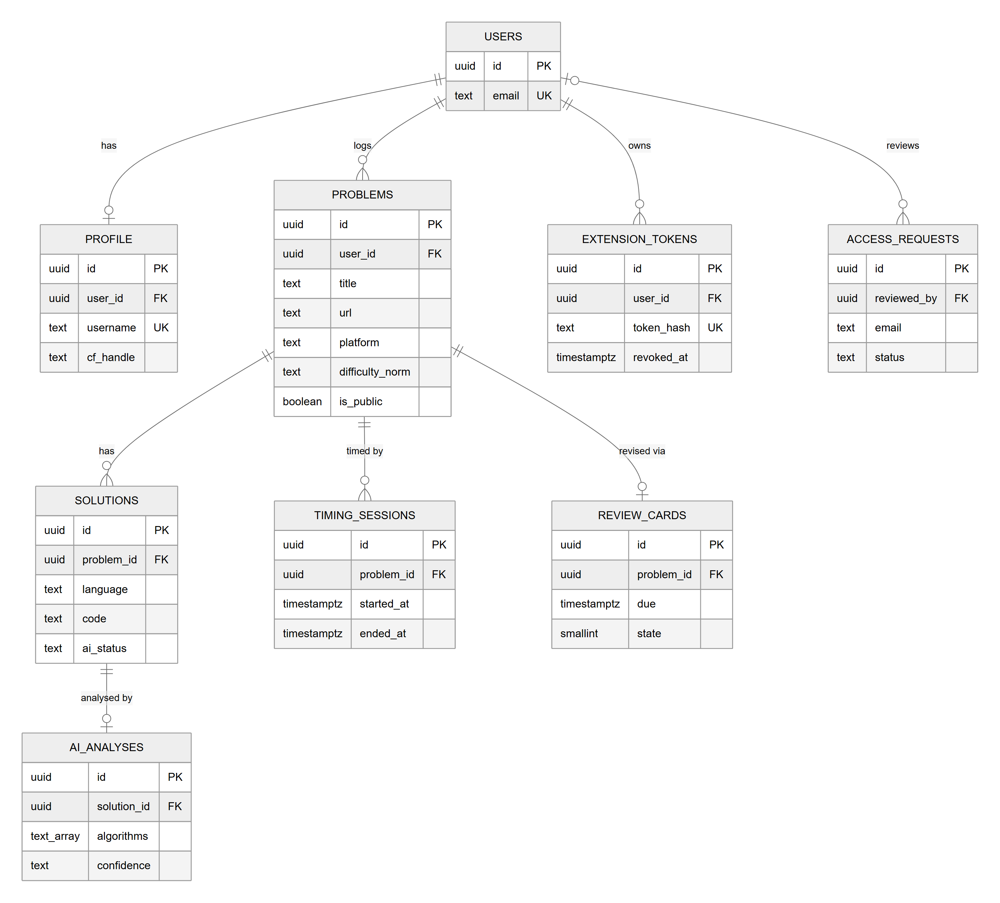

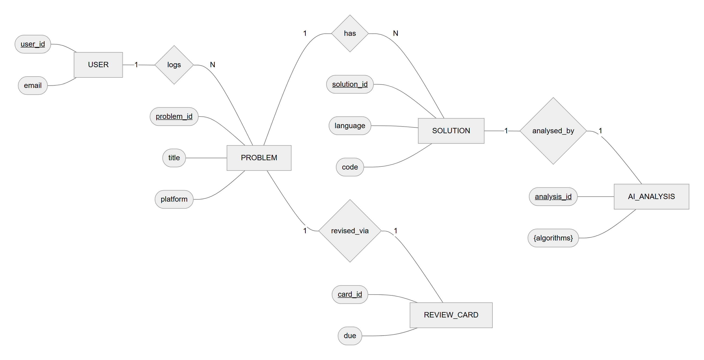

### 4.9 Package, Component and Deployment Diagrams

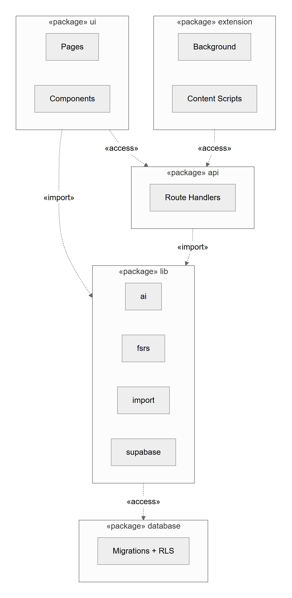

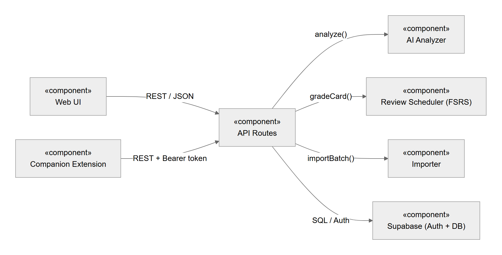

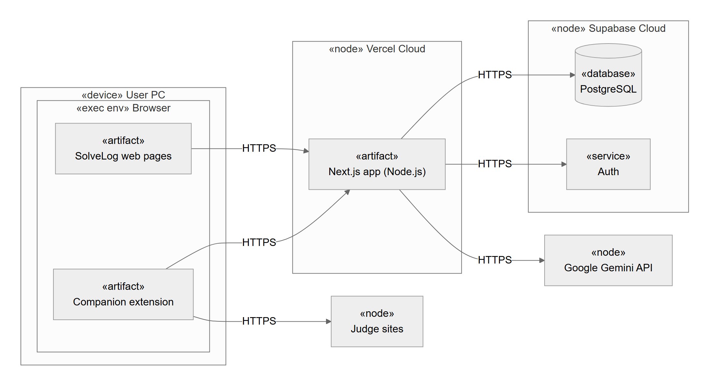

### 4.10 Data Flow Diagrams

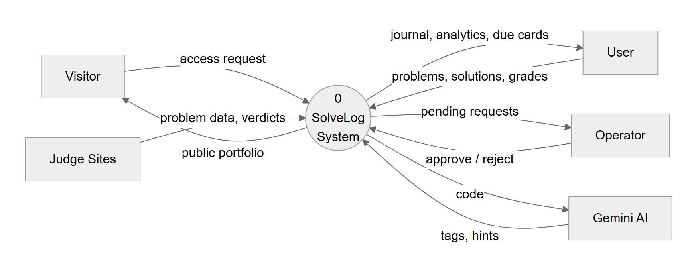

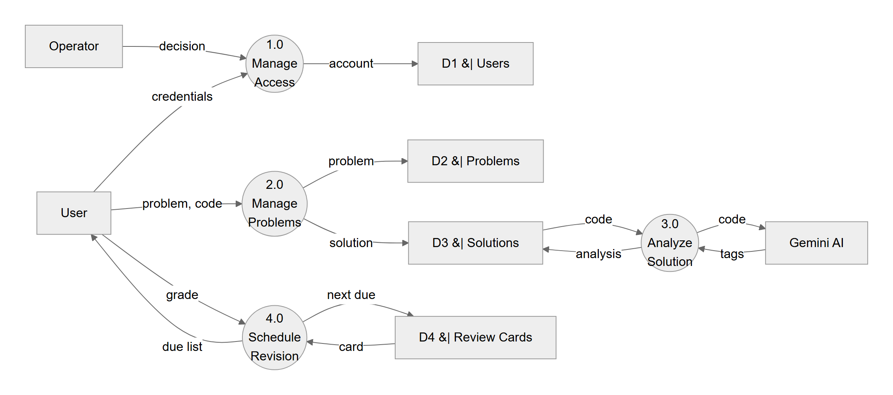

### 4.11 Control Flow Graph

The CFG for `cfRatingToDifficulty()` (`lib/difficulty.ts`) is used for basis-path testing in
Section 6.4.

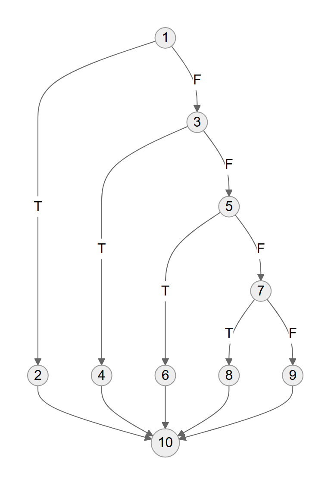

## 5. Project Estimation

### 5.1 Size Metrics (measured)

Lines of code were counted from the repository (TypeScript/TSX source, blank lines and comments
included, generated files and dependencies excluded).

| Module | Files | LOC |
|---|---:|---:|
| `app/` (pages + API routes) | 65 | 8,486 |
| `components/` (UI) | 55 | 7,686 |
| `lib/` (domain logic, AI, FSRS, import) | 39 | 3,025 |
| `extension/` (entrypoints + lib) | 24 | 3,153 |
| `types/` | 1 | 136 |
| **Application total** | **184** | **22,486 (≈ 22.5 KLOC)** |
| `supabase/migrations/` (SQL) | 17 | 1,029 |
| Tests (web + extension) | 20 | 1,536 |

### 5.2 Function Point Analysis

**Unadjusted Function Points (UFP)**

| Component | Simple | Average | Complex | UFP |
|---|---|---|---|---:|
| External Inputs (EI): add/edit/delete problem, add/edit solution, grade, suspend, profile, AI key, access request, approve/reject, capture, import, timer, publish, verify handle | 5 × 3 | 8 × 4 | 3 × 6 | 65 |
| External Outputs (EO): analytics, AI analysis, portfolio, achievement card, badge, revision queue | — | 4 × 5 | 2 × 7 | 34 |
| External Inquiries (EQ): problem search, problem detail, metadata lookup, review queue, token check, access-request list | 2 × 3 | 4 × 4 | — | 22 |
| Internal Logical Files (ILF): the 12 application tables | 8 × 7 | 4 × 10 | — | 96 |
| External Interface Files (EIF): Supabase Auth users, Gemini, Codeforces API, LeetCode GraphQL | 2 × 5 | 2 × 7 | — | 24 |
| **Total UFP** | | | | **241** |

**Value Adjustment Factor.** The 14 general system characteristics were rated 0–5:
data communications 5, distributed processing 4, performance 3, heavily-used configuration 2,
transaction rate 2, online data entry 5, end-user efficiency 4, online update 4, complex
processing 3, reusability 3, installation ease 2, operational ease 3, multiple sites 3,
facilitate change 4. **Σ = 47**.

VAF = 0.65 + 0.01 × 47 = **1.12**

**FP = 241 × 1.12 = 269.9 ≈ 270 FP**

Using a typical JavaScript/TypeScript gearing factor of ~47 LOC/FP, this predicts ≈ 12.7 KLOC.
The measured 22.5 KLOC is higher because about a third of the code is presentation (custom
animated paper-themed UI components), which function points do not count.

### 5.3 COCOMO (Basic), Organic Mode

KLOC = 22.5; organic constants a = 2.4, b = 1.05, c = 2.5, d = 0.38.

| Quantity | Formula | Result |
|---|---|---|
| Effort | E = 2.4 × (22.5)^1.05 | **63.1 person-months** |
| Development time | D = 2.5 × (63.1)^0.38 | **12.1 months** |
| Average staff | P = E / D | **5.2 persons** |
| Productivity | KLOC / E | 0.36 KLOC/PM (356 LOC/PM) |

### 5.4 COCOMO (Intermediate)

Nominal effort (organic, a = 3.2): Enom = 3.2 × (22.5)^1.05 = 84.1 PM.

| Cost driver | Rating | Multiplier |
|---|---|---:|
| RELY: required reliability (security-critical data isolation) | High | 1.15 |
| DATA: database size | High | 1.08 |
| CPLX: product complexity (AI, scheduling, parsers) | High | 1.15 |
| MODP: modern programming practices | High | 0.91 |
| TOOL: use of software tools (frameworks, BaaS, CI) | Very High | 0.83 |
| All others | Nominal | 1.00 |
| **EAF** | | **1.079** |

**E = 84.1 × 1.079 ≈ 90.7 person-months.**

### 5.5 Cost Estimate

Using an indicative fresher developer cost of ₹40,000 per person-month (Basic COCOMO):
63.1 PM × ₹40,000 ≈ **₹25.2 lakh**. Running cost on the current free tiers (Vercel Hobby,
Supabase Free, Gemini free tier with BYOK) is **₹0 per month**.

### 5.6 Discussion: Estimated vs Actual

The project was built by **one developer**, far below the 5-person, 12-month team that COCOMO
predicts. The gap is expected and has known causes. COCOMO was calibrated on 1970s–80s projects
where every subsystem was written from scratch. Here, whole subsystems come off the shelf:
authentication, database and REST API (Supabase), hosting and CI/CD (Vercel), UI primitives,
the FSRS algorithm (ts-fsrs) and the code editor (Monaco). AI-assisted development tools also
raise individual productivity. The estimates are therefore best read as the effort to build an
equivalent system *without* those platforms.

### 5.7 Schedule (Phases)

| Phase | Work |
|---|---|
| 1. Requirements & planning | Problem study, feature list, data model, security model |
| 2. Core backend | Schema and migrations, RLS, auth, problems/solutions APIs |
| 3. Extension | Judge parsers, capture, timer widget, background import |
| 4. AI layer | Provider abstraction (Gemini + Groq), async analysis, BYOK encryption, caching |
| 5. Revision & analytics | FSRS integration, queue, grading, dashboards |
| 6. UI/UX | Paper-theme redesign, accessibility and contrast pass, dark mode |
| 7. Testing & hardening | Unit/fixture tests, security audit fixes, rate limiting |
| 8. Launch | Deploy to Vercel, rebrand to SolveLog, public repository |

## 6. Testing

### 6.1 Testing Strategy and Techniques Used

| Level / technique | What was done | Tooling |
|---|---|---|
| **Unit testing** | Pure modules (FSRS wrapper, difficulty mapping, pattern normalisation, AES-GCM secret box, import batching, judge parsers) tested in isolation | TypeScript test scripts run with `tsx` |
| **Black-box: Equivalence Partitioning** | Inputs split into valid and invalid classes (e.g., rating ≤ 0 / missing vs each difficulty band; valid vs invalid email; valid vs revoked token) | Unit tests + HTTP tests |
| **Black-box: Boundary Value Analysis** | Values on and around each boundary: 0, 1299/1300, 1899/1900, 2399/2400 | Unit tests |
| **White-box: Basis Path testing** | CFG drawn, cyclomatic complexity computed (V(G) = 5), one test per independent path | Section 6.4 |
| **Fixture-based (regression) testing** | Saved real HTML/JSON pages from Codeforces, LeetCode, AtCoder and CodeChef are re-parsed on every run to catch parser regressions | Extension test suite |
| **Integration testing** | Route handler + Supabase + RLS exercised end to end during development | Manual + browser |
| **System / API testing** | HTTP requests against the deployed production build | `curl` |
| **Security testing** | Unauthenticated and invalid-token access to protected endpoints; method restrictions; input validation | `curl` |
| **Static analysis** | Type checking and linting of the whole code base | `tsc --noEmit`, ESLint |
| **Performance testing** | Time-to-first-byte measurement; Lighthouse audit | `curl`, Lighthouse |
| **User acceptance testing** | Developer and invited users walked through core flows on the live app | Manual |

### 6.2 Automated Unit Test Results

All suites were executed on **1 November 2026** (Node.js 22.17).

| # | Suite | Module under test | Assertions | Result |
|---|---|---|---:|---|
| 1 | `difficulty.test.ts` | Difficulty bands, enum allowlists | 29 | PASS |
| 2 | `fsrs.test.ts` | FSRS card creation, grading, serialisation | 20 | PASS |
| 3 | `import-batch.test.ts` | Bulk import batching and dedup | 20 | PASS |
| 4 | `import-judges.test.ts` | Judge API response parsing | 24 | PASS |
| 5 | `solution-provenance.test.ts` | Verdict / submission provenance | 21 | PASS |
| 6 | `verify.test.ts` | Handle-verification logic | 18 | PASS |
| 7 | `patterns.test.ts` | Pattern taxonomy | 17 | PASS |
| 8 | `html-text.test.ts` | HTML → text sanitising | 14 | PASS |
| 9 | `ai-key-validate.test.ts` | AI key format validation | 10 | PASS |
| 10 | `ai-schema.test.ts` | AI response schema validation | 10 | PASS |
| 11 | `secret-box.test.ts` | AES-256-GCM encrypt/decrypt, tamper detection | 8 | PASS |
| 12 | `ai-registry.test.ts` | Provider registry and fallback | 6 | PASS |
| 13 | `normalize-patterns.test.ts` | AI tag normalisation | 6 | PASS |
| 14 | `ext/leetcode.test.ts` | LeetCode page parser | 16 | PASS |
| 15 | `ext/deep-leetcode.test.ts` | LeetCode deep import | 42 | PASS |
| 16 | `ext/deep-codeforces.test.ts` | Codeforces deep import | 41 | PASS |
| 17 | `ext/atcoder_codechef.test.ts` | AtCoder / CodeChef parsers | 17 | PASS |
| 18 | `ext/cf-statement.test.ts` | Codeforces statement extraction | 13 | PASS |
| 19 | `ext/mathjax.test.ts` | MathJax → text conversion | 7 | PASS |
| | **Total** | **19 suites** | **339** | **339 / 339 PASS (100%)** |

### 6.3 Black-Box Test Cases: `cfRatingToDifficulty(rating)`

Equivalence classes: **E1** missing or ≤ 0 → unknown; **E2** 1–1299 → easy; **E3** 1300–1899 →
medium; **E4** 1900–2399 → hard; **E5** ≥ 2400 → expert. Boundary values were taken on each
edge.

| TC ID | Technique | Input | Expected | Actual | Status |
|---|---|---|---|---|---|
| BB-01 | EP (E1) | `undefined` | unknown | unknown | PASS |
| BB-02 | EP (E1) | `null` | unknown | unknown | PASS |
| BB-03 | BVA (E1 edge) | 0 | unknown | unknown | PASS |
| BB-04 | EP (E2) | 800 | easy | easy | PASS |
| BB-05 | BVA (E2 upper) | 1299 | easy | easy | PASS |
| BB-06 | BVA (E3 lower) | 1300 | medium | medium | PASS |
| BB-07 | BVA (E3 upper) | 1899 | medium | medium | PASS |
| BB-08 | BVA (E4 lower) | 1900 | hard | hard | PASS |
| BB-09 | BVA (E4 upper) | 2399 | hard | hard | PASS |
| BB-10 | BVA (E5 lower) | 2400 | expert | expert | PASS |

### 6.4 White-Box Test Cases: Basis Path Testing

From the CFG in Section 4.11: N = 10 nodes, E = 13 edges.

**Cyclomatic complexity V(G) = E − N + 2 = 13 − 10 + 2 = 5** (check: 4 predicate nodes + 1 = 5).
So there are 5 independent paths, and 5 test cases are enough for full path coverage.

| TC ID | Independent path | Input | Expected | Actual | Status |
|---|---|---|---|---|---|
| WB-01 | 1 → 2 → 10 | 0 | unknown | unknown | PASS |
| WB-02 | 1 → 3 → 4 → 10 | 800 | easy | easy | PASS |
| WB-03 | 1 → 3 → 5 → 6 → 10 | 1300 | medium | medium | PASS |
| WB-04 | 1 → 3 → 5 → 7 → 8 → 10 | 1900 | hard | hard | PASS |
| WB-05 | 1 → 3 → 5 → 7 → 9 → 10 | 2400 | expert | expert | PASS |

Result: **100% statement, branch and basis-path coverage** for this function.

### 6.5 Other Functional Unit Test Cases (selected)

| TC ID | Module | Test | Expected | Status |
|---|---|---|---|---|
| UT-01 | FSRS | New card has state New (0) and 0 reps | state = 0, reps = 0 | PASS |
| UT-02 | FSRS | Preview next-due dates for all four grades | due(Again) ≤ due(Good) ≤ due(Easy) | PASS |
| UT-03 | FSRS | Stored card round-trips through JSON and is graded again | reps = 2, dates stored as ISO strings | PASS |
| UT-03b | FSRS | Grade value validation | 1–4 accepted; 0, 5 and "good" (string) rejected by `isGrade` | PASS |
| UT-04 | Secret box | Encrypt then decrypt | Original plaintext | PASS |
| UT-05 | Secret box | Tampered ciphertext | Decryption throws (auth-tag check) | PASS |
| UT-06 | Secret box | Wrong master key | Decryption fails | PASS |
| UT-07 | Difficulty | LeetCode "Medium" | medium | PASS |
| UT-08 | Difficulty | Language "brainfuck" | rejected by allowlist | PASS |
| UT-09 | AI schema | Response schema adapted per provider | Gemini drops unsupported `$schema`/`additionalProperties`; Groq keeps strict `additionalProperties:false`; enums preserved | PASS |
| UT-10 | Import batch | Same problem twice in one batch | One problem row, both solutions kept | PASS |
| UT-11 | Import batch | Invalid problem in batch | Counted as invalid; its solutions dropped | PASS |

### 6.6 System and Security Test Cases (production deployment)

Executed on **1 November 2026** against `https://solvelog.vercel.app` with `curl`, signed out.

| TC ID | Test | Request | Expected | Actual | Status |
|---|---|---|---|---|---|
| ST-01 | Landing page loads | `GET /` | 200 | 200 | PASS |
| ST-02 | Login page loads | `GET /login` | 200 | 200 | PASS |
| ST-03 | Admin is protected | `GET /admin` (no session) | Redirect to `/login` | 307 → `/login` | PASS |
| ST-04 | Unknown portfolio | `GET /u/this-handle-does-not-exist-xyz` | 404 | 404 | PASS |
| ST-05 | Unknown route | `GET /nonexistent-page-zzz` | 404 | 404 | PASS |
| ST-06 | Grade needs auth | `POST /api/review/grade` | 401 | 401 | PASS |
| ST-07 | Review queue needs auth | `GET /api/review/queue` | 401 | 401 | PASS |
| ST-08 | Create solution needs auth | `POST /api/solutions` | 401 | 401 | PASS |
| ST-09 | Account delete needs auth | `DELETE /api/account` | 401 | 401 | PASS |
| ST-10 | Extension needs token | `GET /api/ext/me` (no token) | 401 | 401 | PASS |
| ST-11 | Invalid extension token rejected | `GET /api/ext/me` with `Bearer invalidtoken123` | 401 | 401 | PASS |
| ST-12 | Email validation | `POST /api/access-requests` `{"email":"not-an-email"}` | 400 "A valid email is required." | 400, same message | PASS |
| ST-13 | Method restriction | `GET /api/invites` (POST-only route) | 405 | 405 | PASS |
| ST-14 | SEO files | `GET /robots.txt`, `GET /sitemap.xml` | 200 | 200, 200 | PASS |
| ST-15 | Legal page | `GET /privacy` | 200 | 200 | PASS |
| ST-16 | Public problem list (anonymous) | `GET /api/problems` | 200 with published problems | **500** "Failed to fetch problems" | **FAIL** (env.) |
| ST-17 | Health check | `GET /api/heartbeat` | 200 `{ok:true}` | **500** "Heartbeat failed" | **FAIL** (env.) |
| ST-18 | Performance: TTFB | `GET /` | < 1 s | 0.43 s (total 0.45 s) | PASS |

**Defect analysis for ST-16 and ST-17.** Both endpoints query the database directly. During the
test run the Supabase project host did not resolve in DNS, so every database call failed. This
is consistent with the Supabase free tier, which automatically **pauses** projects after a period
of inactivity. The application code handled it correctly: it returned a clean 500 JSON error with
no stack trace or secret leaked, and every non-database route kept working. This is an
**environment** defect, not a code defect. Corrective action: resume the Supabase project from
its dashboard and re-run ST-16/ST-17; long-term, schedule a keep-alive call to `/api/heartbeat`
(the endpoint already exists for this purpose).

### 6.7 User Acceptance Test Cases (manual, during development)

| TC ID | Scenario | Expected | Status |
|---|---|---|---|
| UAT-01 | Request access → operator approves → invite email → set password → sign in | User lands on dashboard | PASS |
| UAT-02 | Add problem from a Codeforces URL | Title, rating and tags auto-filled | PASS |
| UAT-03 | Add solution with AI key set | Tags appear after a few seconds; status "done" | PASS |
| UAT-04 | Add solution with no AI key | Saved; status "none"; no error | PASS |
| UAT-05 | Capture an accepted LeetCode problem via extension | Problem and solution appear in journal | PASS |
| UAT-06 | Extension floating timer start/stop | Timing session saved against problem | PASS |
| UAT-07 | Revise: grade Good | Card leaves today's queue; next due in future | PASS |
| UAT-08 | Toggle problem public | Appears on `/u/<handle>` for a signed-out visitor | PASS |
| UAT-09 | User A cannot see User B's private problems | Only A's rows in A's dashboard | PASS (after fix 509c074) |
| UAT-10 | Revoke extension token | Extension requests return 401 | PASS |

### 6.8 Static Analysis Results

| Check | Command | Result |
|---|---|---|
| Type checking | `tsc --noEmit` | **0 errors**: PASS |
| Linting | `eslint .` | 140 errors, 349 warnings (non-blocking). Breakdown of errors: 98 `no-explicit-any`, 19 `react-hooks/set-state-in-effect`, 9 `ban-ts-comment`, 6 `react-hooks/purity`, 8 other. 14 of the 140 are in generated extension type files. None affect the production build. Logged as technical debt. |
| Production build | `next build` | Succeeds (deployed on Vercel) |

### 6.9 Defects Found and Fixed During Development (selected)

| ID | Defect | Severity | Root cause | Fix |
|---|---|---|---|---|
| D-01 | Admin views showed other users' public problems | High | Relied on RLS alone; the public-read policy also matched other users' published rows | Explicit `.eq("user_id", user.id)` on all "my data" queries |
| D-02 | Settings inputs lost focus after one character | Medium | Component defined inside render, so it was re-mounted every keystroke | Hoisted the component; removed SSR gating on mutable state |
| D-03 | `ai_status` stuck on "pending" | Medium | Fire-and-forget self-fetch was dropped when the serverless function froze | AI runs in-process inside `after()` |
| D-04 | Extension import failed for session-gated code | High | Background service worker lacked judge cookies | Import runs in a background judge tab via content script |
| D-05 | Difficulty thresholds differed between routes | Low | Duplicated constants | Single source of truth in `lib/difficulty.ts` (covered by BB-01…BB-10) |

### 6.10 Test Summary

| Category | Executed | Passed | Failed | Pass rate |
|---|---:|---:|---:|---:|
| Automated unit assertions | 339 | 339 | 0 | 100% |
| Black-box cases (EP/BVA) | 10 | 10 | 0 | 100% |
| White-box basis paths | 5 | 5 | 0 | 100% |
| System / security (production) | 18 | 16 | 2* | 88.9% |
| User acceptance | 10 | 10 | 0 | 100% |

\* Both failures are environment-caused (paused database), as analysed in Section 6.6.

## 7. Implementation and Screenshots

**Technology stack:** Next.js 16 (App Router), React 19, TypeScript 5, Tailwind CSS 4, Supabase
(PostgreSQL + Auth + RLS), ts-fsrs, Google Gemini (`@google/genai`) with Groq fallback, Monaco
Editor, Recharts, GSAP, WXT (extension framework), Sentry (error monitoring), Vercel (hosting).

Screenshots were captured from the running application during development.

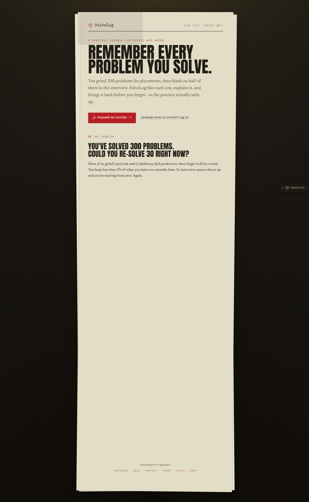
*Figure 7.1: Landing page*

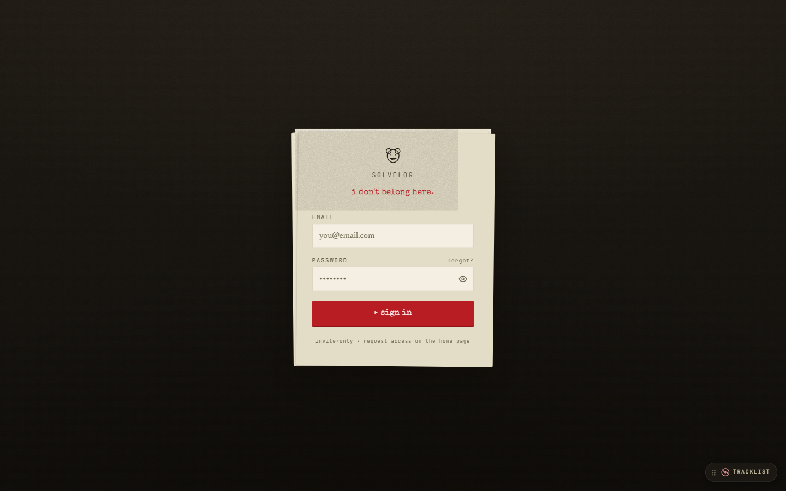
*Figure 7.2: Sign-in page*

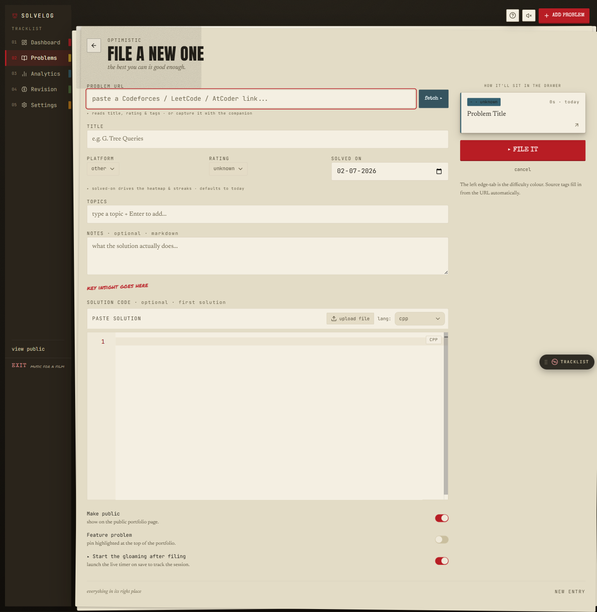
*Figure 7.3: Add problem*

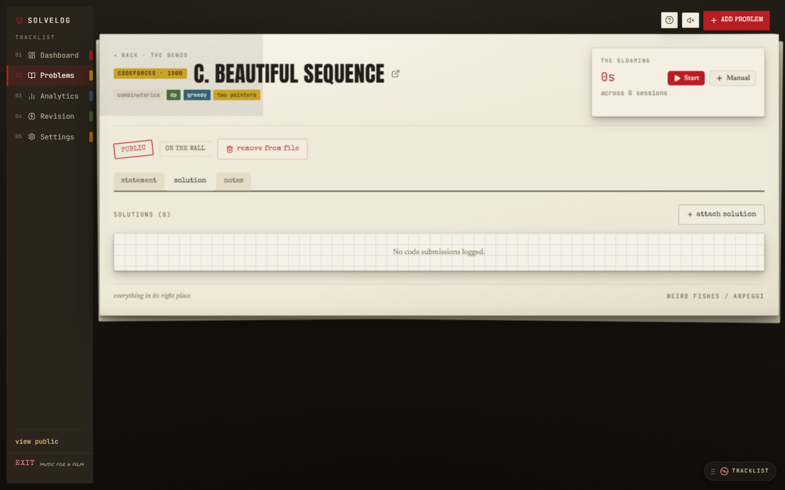
*Figure 7.4: Problem detail with solution and AI analysis*

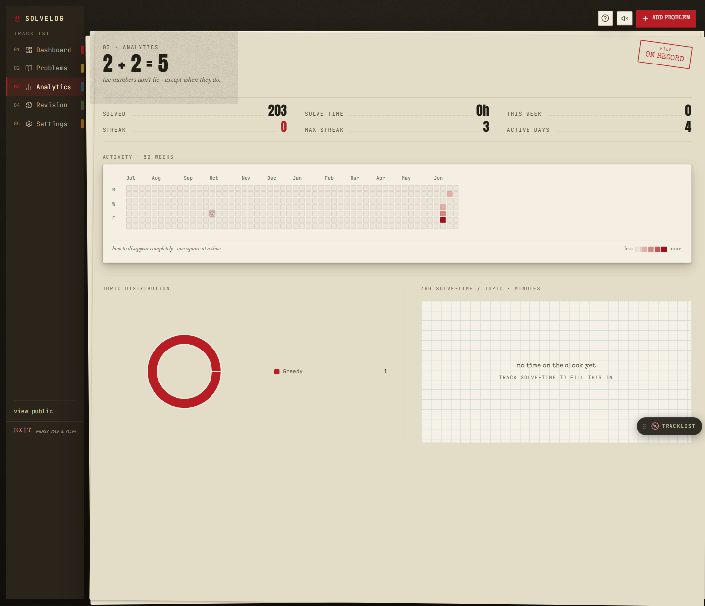
*Figure 7.5: Analytics*

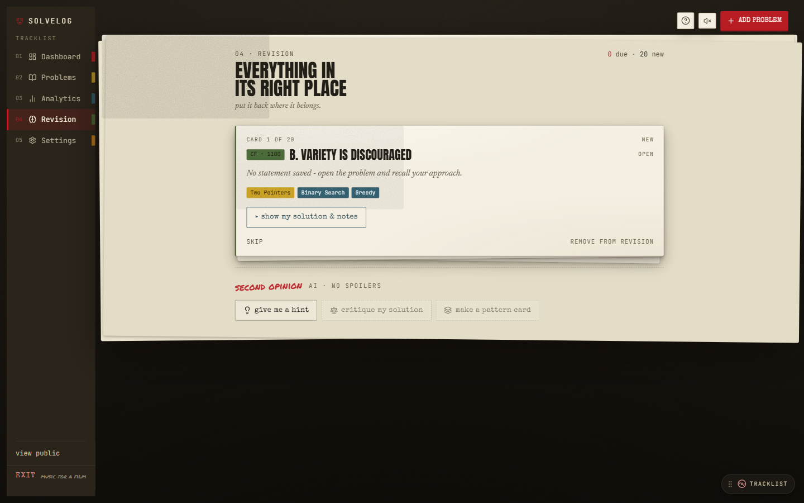
*Figure 7.6: FSRS revision queue*

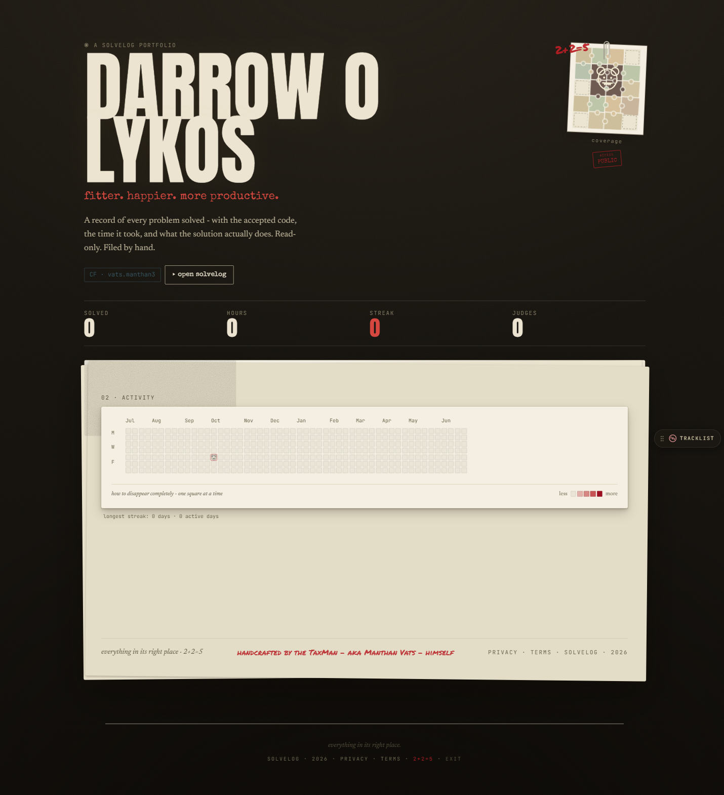
*Figure 7.7: Public portfolio*

## 8. Conclusion and Future Scope

### 8.1 Conclusion

SolveLog meets its three goals. **Retention** comes from FSRS-scheduled revision. **Insight**
comes from AI pattern tagging, coverage analytics and on-demand hints. **Proof of work** comes
from a curated, private-by-default public portfolio. Security is enforced at the database layer
with RLS, backed by explicit ownership checks, encrypted AI keys, hashed extension tokens and rate
limiting. The automated suite of 339 assertions passes completely, and system tests against
production confirmed the expected authentication and validation behaviour. The only failures were
traced to a paused database, not to the application.

### 8.2 Limitations

- Bulk import currently supports Codeforces and LeetCode deeply; other judges support capture only.
- AI features depend on the user providing a Gemini key.
- Free-tier hosting pauses the database after inactivity.

### 8.3 Future Scope

- Keep-alive scheduler (cron) to prevent free-tier database pauses
- Deep import for AtCoder and CodeChef
- Contest-mode practice timer and virtual contests
- Mentor view: share a read-only journal with a coach
- Clear the ESLint backlog (replace `any` types) and add end-to-end browser tests (Playwright)

## 9. References

1. IEEE Std 830-1998, *IEEE Recommended Practice for Software Requirements Specifications*.
2. R. S. Pressman, *Software Engineering: A Practitioner's Approach*, 8th ed., McGraw-Hill.
3. B. W. Boehm, *Software Engineering Economics*, Prentice Hall, 1981 (COCOMO).
4. A. J. Albrecht, "Measuring Application Development Productivity", IBM, 1979 (Function Points).
5. Object Management Group, *Unified Modeling Language Specification*, v2.5.1.
6. T. J. McCabe, "A Complexity Measure", *IEEE Transactions on Software Engineering*, 1976.
7. J. Ye et al., *FSRS: Free Spaced Repetition Scheduler*, open-spaced-repetition project.
8. Next.js Documentation: https://nextjs.org/docs
9. Supabase Documentation (Auth, Row Level Security): https://supabase.com/docs
10. Google Gemini API Documentation: https://ai.google.dev

---

## Appendix A: Glossary

**Accepted (AC):** judge verdict meaning the solution passed all tests. **Lapse:** forgetting a
reviewed card (graded Again). **Pattern:** a reusable problem-solving technique such as sliding
window or binary search on answer. **Portfolio:** the public page at `/u/<handle>`.

## Appendix B: Requirements Traceability Matrix

| Requirement | Design artefact | Test case(s) |
|---|---|---|
| FR-1 | Use case, DFD-0 | ST-12, UAT-01 |
| FR-2 | Use case, class (Operator) | ST-13, UAT-01 |
| FR-3 | Use case, deployment | ST-02, ST-03, UAT-01 |
| FR-4 | Class, ER, activity | ST-08, UAT-02 |
| FR-5 | Activity | BB-01…BB-10, UT-07, UAT-02 |
| FR-6 | Sequence (add solution) | ST-08, UT-08, UAT-03 |
| FR-7 | Class (TimingSession) | UAT-06 |
| FR-8 | Sequence, DFD-1 (3.0) | UT-09, UAT-03, UAT-04 |
| FR-9 | State, communication | UT-01…UT-03, ST-06, UAT-07 |
| FR-10 | State (Suspended) | ST-07 |
| FR-12 | Component | UAT (dashboard) |
| FR-13 | ER (`is_public`) | UAT-08, UAT-09 |
| FR-14 | Deployment | ST-04, UAT-08 |
| FR-16 | Sequence (capture) | ST-10, ST-11, UAT-05 |
| FR-17 | Package (extension) | UT-10, ext suites 14–19 |
| FR-18 | ER (extension_tokens) | ST-11, UAT-10 |
| FR-19 | Class, NFR-2 | UT-04…UT-06 |
| FR-20 | ER (ON DELETE CASCADE) | ST-09 |
| NFR-5 | — | ST-18 |
